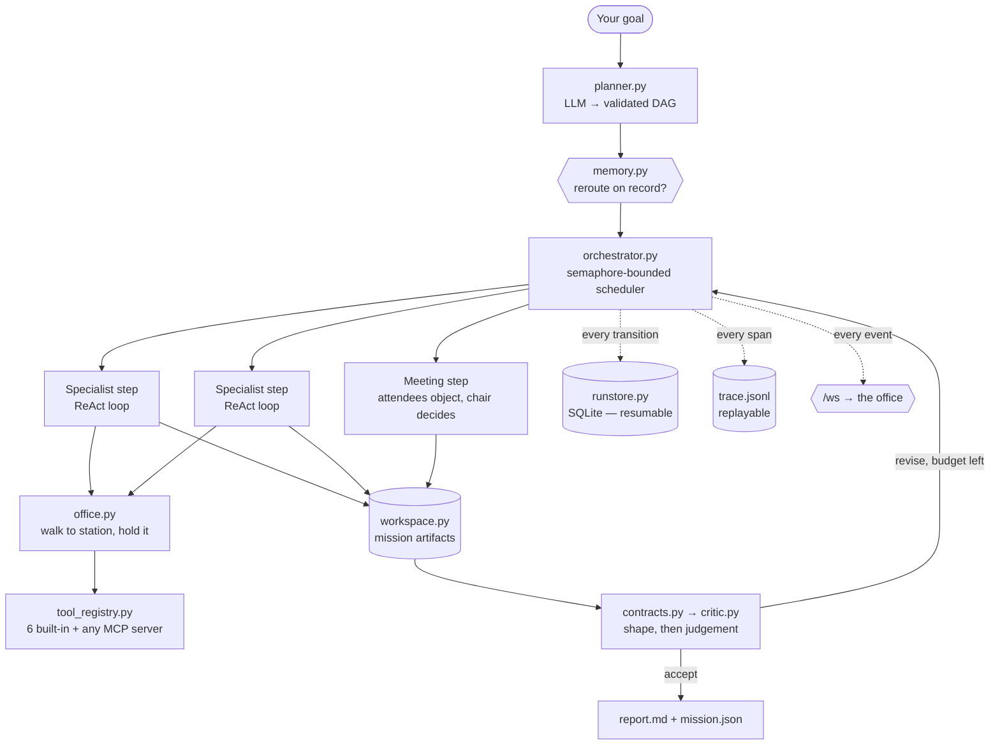

# AgentHQ

**A multi-agent LLM harness you can watch, price, resume and replay — with a live
2D pixel-art office as its debugger.**

Dispatch a goal and the boss plans it into a DAG. Specialists run the independent
steps at the same time, walk across the office to the station each tool lives at,
queue when one is busy, hand each other real files, argue at the conference table,
and get their work checked before anything downstream reads it. Every mission
leaves a trace you can replay through the same office, step by step.

The office is not decoration. It **is** the observability layer: a queue at the
ops console is a real `asyncio` queue, and moving a station in the map changes how
long missions take.

> Docs map: [[ARCHITECTURE]] · [[STACK]] · [[DECISIONS]] · [[PROTOCOL]] · [[TODO]]

---

## How a mission runs



Each of those boxes is one module, and each one is switchable off in
`backend/config.py` — turning a subsystem off returns the harness to how it
behaved before that subsystem existed.

---

## Run it in one command

```bash
docker compose up          # → http://localhost:8080
```

No key required. Without a credential every agent falls back to a deterministic
simulator that produces realistic tool calls and outputs, so a fresh clone runs a
complete mission end to end — and every number that came from the simulator is
tagged `~estimated` rather than presented as a reading.

Or without Docker:

```bash
pip install -r requirements.txt
cd backend && python main.py        # uvicorn on http://localhost:8080
```

`main.py` mounts `frontend/` as static files, so the UI is served from the same
origin and the WebSocket at `/ws` connects with no CORS or port juggling.

---

## Is it any good? — the eval harness

`evals/` holds 14 golden tasks across four shapes (research, code, meetings,
adversarial), a cassette record/replay transport that makes a scored run
reproducible, and an LLM judge that scores each rubric line against the **artifact
files** — never the synthesised briefing, which is string assembly around a
template and would score identically on a mission where every specialist produced
nothing.

```bash
python -m evals.runner --suite all --replay      # offline, no key, deterministic
```

| task | mode | structural | quality | cost | p50 latency | pass@k |
|---|---|---|---|---|---|---|
| `adversarial_ambiguous` | simulate | 86% | — | $0.0000 | 10.9s | 0/1 |
| `adversarial_missing_tool` | simulate | 100% | — | $0.0000 | 10.8s | 1/1 |
| `adversarial_trivial` | simulate | 86% | — | $0.0000 | 10.9s | 0/1 |
| `approach_standup` | simulate | 88% | — | $0.0000 | 10.9s | 0/1 |
| `battery_comparison` | simulate | 88% | — | $0.0000 | 10.9s | 0/1 |
| `battery_team_review` | simulate | 88% | — | $0.0000 | 10.9s | 0/1 |
| `code_cache_bug` | simulate | 100% | — | $0.0000 | 10.8s | 1/1 |
| `code_review_fix` | simulate | 100% | — | $0.0000 | 13.1s | 1/1 |
| `ev_charging_standards` | simulate | 100% | — | $0.0000 | 10.9s | 1/1 |
| `grid_storage_tradeoffs` | simulate | 100% | — | $0.0000 | 10.9s | 1/1 |
| `heat_pump_handoff` | simulate | 100% | — | $0.0000 | 10.9s | 1/1 |
| `india_news_brief` | simulate | 100% | — | $0.0000 | 10.8s | 1/1 |
| `solar_efficiency` | simulate | 100% | — | $0.0000 | 10.9s | 1/1 |
| `solid_state_batteries` | simulate | 100% | — | $0.0000 | 10.8s | 1/1 |
| **aggregate** | **simulate** | **95%** | **—** | **$0.0000** | **10.9s** | **10/14** |

Read those numbers as narrowly as they are meant. **structural** is the `expect`
block — step count, agents involved, artifacts produced, budgets respected — and
is deterministic with no model involved. **quality** is empty because no cassettes
have been recorded yet: that column needs a real key and real spend, and an empty
cell is the honest way to say so rather than a number that came from nowhere.

Two failing rows are deliberate and documented in [[TODO]]: `adversarial_trivial`
fans a one-line question out to a full four-step plan, and
`adversarial_missing_tool` targets the planner's blindness to which tools an agent
actually holds. They are there to be measured, not to pass.

The live scorecard, with a delta against the previous run, is
[`evals/scorecard.md`](evals/scorecard.md).

---

## The office, as an instrument

The right-hand HUD is not a status page. Four panels read the same event stream
the renderer does (contract in [[PROTOCOL]]):

- **Execution plan** — the DAG as a real graph, ranked by dependency depth so a
  fan-out reads as a fan-out. A node's fill is the agent that owns it, its ring is
  how far it got, and it carries what it cost. A `⇄` badge means memory took the
  step off the planner's pick; a scored badge means a reviewer judged it, in red
  when it was rejected and completed anyway because the repair budget was spent.
- **Mission cost** — live cost, tokens, wall clock and a per-step latency strip.
  Every figure is per-mission, and marked `~est` when it came from the simulator.
- **Trace replay** — pick any past mission and drive the office from its
  `trace.jsonl` instead of the live socket: play, pause, scrub, 1×–8×. The
  renderer is not forked; recorded spans are turned back into the same events the
  WebSocket sends. **This makes the office a time-travel debugger for multi-agent
  runs** — every past run is watchable again, at the speed you choose.
- **Mission output** — the goal, the finished briefing, and every artifact with
  its real body.

---

## What is actually interesting here

| Decision | Why | Where |
|---|---|---|
| **Typed retry classification** | A 429 is "later", a 401 is "no". Retrying the second only hides it — so the default is *not* to retry. | `llm.py` |
| **Contract, then critic** | Regex checks the shape for free; a small model judges the substance. A rejected step is re-dispatched at most once, because an unbounded repair loop is how an agent system spends a whole budget on one step. | `contracts.py`, `critic.py` |
| **Resumable execution** | Every transition is written to SQLite *before* its event is emitted, so a killed process can be picked up: completed steps are skipped and their artifacts rehydrated. | `runstore.py` |
| **Quality-weighted routing** | Memory blends success rate with the critic's score and decays old episodes by half-life, so an agent that succeeded badly stops outranking one that succeeded well. | `memory.py` |
| **Semantic recall with no dependency** | Hashed word + character-trigram embeddings: no key, no network, identical across processes. "Optimise the caching layer" and "cache optimisation" score 0.000 lexically and 0.176 semantically. | `embeddings.py` |
| **Meetings that argue** | Attendees each get one bounded turn to object before the chair sums up — concurrent, capped, and billed to their own token usage. | `debate.py` |
| **Sandboxed by default** | The terminal tool is an allowlist over `argv[0]`, `shell=False`, jailed cwd, scrubbed environment. Refusals come back as readable payloads the model can route around. | `tools/terminal.py` |
| **Real telemetry** | Provider token counts, priced per model that actually answered, one span per mission/step/turn/tool/call. | `pricing.py`, `tracing.py` |

Full rationale for each, including the ones that did not work, is in
[[DECISIONS]].

---

## MCP

The office speaks Model Context Protocol in both directions.

**Other people's tools, in here.** Copy `backend/mcp_servers.example.json` to
`backend/mcp_servers.json`, and set `MCP_ENABLED=true`:

```json
{ "mcpServers": {
    "filesystem": {
      "command": "npx",
      "args": ["-y", "@modelcontextprotocol/server-filesystem", "./backend/data/missions"],
      "grant_to": ["coder", "data_analyst"]
    },
    "docs": { "url": "https://example.com/mcp", "grant_to": ["researcher"] }
} }
```

Every tool a server lists is registered as `mcp__<server>__<tool>` and is then an
ordinary tool: same `tool.called` / `tool.result` events, same timing, and the
agent walks to the **Integrations Bench** station to use it. `grant_to` picks who
may call it; omit it and every specialist gets it. A server that will not connect
is a logged warning — the office still opens.

**This office, out there.** `python -m mcp_server` (from `backend/`) serves
`run_mission`, `get_mission` and `list_agents` over stdio, so Claude Code or any
MCP client can drive the harness:

```json
{ "mcpServers": {
    "agenthq": { "command": "python", "args": ["-m", "mcp_server"], "cwd": "backend" }
} }
```

Both need `pip install -r requirements-dev.txt` (the `mcp` package is imported
lazily and is not required to run the app).

---

## Working on it

### Frontend only (art / layout work)

```bash
cd frontend
python -m http.server 8899
```

The WebSocket fails to connect and `app.js` falls back to a scripted standalone
simulation, so the office animates without a backend. This is the fast loop for
map and rendering changes.

### LLM keys

Optional. Set `GEMINI_API_KEY` (or `OPENAI_API_KEY` / `ANTHROPIC_API_KEY`) in
`backend/.env` or the environment, or point `LLM_API_BASE` at an
OpenAI-compatible gateway. See [[DECISIONS]].

### Tests

```bash
pip install -r requirements-dev.txt
cd backend && python -m pytest -q      # 270 tests, all passing
```

CI runs the same suite on Python 3.10 and 3.12, plus `ruff check` and the eval
smoke suite against its committed cassettes.

There is no JS test runner — adding one would be this project's first node build
step. Two hand-run validators cover what matters instead:

```bash
node tools/check_replay.js      # a real trace.jsonl through the real replay.js
python tools/check_layout.py    # every prop's pixel rectangle against the map
```

The dev set additionally needs `node` on PATH — `preview_map.py` and
`check_layout.py` read the real `office_map.js` through it rather than keeping a
second copy of the layout that could drift. Rebuilding the atlas also needs the
art source packs, which are not in this repo; the built atlas is committed, so
you only need them to regenerate it. See [[STACK]].

---

## Major components

| Area | Path | What it does |
|---|---|---|
| API + WebSocket | `backend/main.py` | FastAPI app, connection manager, event broadcast, static mount |
| Orchestration | `backend/orchestrator.py` | Plans a goal into a DAG, runs independent steps together, repairs and synthesises |
| Planner | `backend/planner.py` | LLM plan → validated DAG, with keyword buckets as the fallback |
| Mission workspace | `backend/workspace.py` | Shared artifact store; one step's output becomes the next one's context |
| Spatial runtime | `backend/office.py` | Tools bound to stations; agents walk to them and queue when one is busy |
| Episodic memory | `backend/memory.py`, `backend/embeddings.py` | Every finished subtask, recalled semantically; quality-weighted routing |
| Durability | `backend/runstore.py`, `backend/api_missions.py` | SQLite run store, mission history, resume, trace endpoint |
| Quality | `backend/contracts.py`, `backend/critic.py` | Is the artifact usable, and is it any good |
| Meetings | `backend/debate.py` | One bounded objection per attendee before the chair decides |
| Interop | `backend/mcp_client.py`, `backend/mcp_server.py` | MCP in both directions |
| Telemetry | `backend/tracing.py`, `backend/pricing.py` | One span per unit of work; real token counts, priced per model |
| Agent engine | `backend/base_agent.py` | ReAct loop: reason → tool call → observe → repeat |
| Event fabric | `backend/event_bus.py` | In-memory async pub/sub, 200-event rolling history |
| Tools | `backend/tool_registry.py`, `backend/tools/` | 6 built-in tools, sandboxed, plus any MCP server |
| Office renderer | `frontend/js/canvas.js` | Tilemap, A* pathing, depth sort, lighting, doors, labels |
| Office data | `frontend/js/office_map.js` | The whole floor plan as data — 40×24 tiles |
| HUD | `frontend/js/hud.js` | Dock, terminal, token gauge, DAG panel, cost panel, mission output |
| Trace replay | `frontend/js/replay.js` | Drives the office from a recorded `trace.jsonl` |
| Asset pipeline | `tools/*.py` | Sprite indexing, synthesis, atlas build, layout validation |

Full detail in [[ARCHITECTURE]].

---

## The agents

| ID | Name | Role | Tools |
|---|---|---|---|
| `orchestrator` | Boss Dave | Planning & synthesis | — |
| `researcher` | Alice | Search, RAG & discovery | web_search, read_file |
| `coder` | Charlie | Code & bug hunting | terminal, code_analysis, read_file, write_file |
| `data_analyst` | Bob | Data & analytics | read_file, list_files, terminal |
| `creative` | Eve | Writing & synthesis | write_file, read_file |

Adding an agent is a new JSON file in `backend/agents/` plus a desk in
`office_map.js` — see [[ARCHITECTURE]].

---

## The honest gaps

Kept current in [[TODO]], which is the file to read before trusting anything
above. The ones worth knowing up front:

- **No hero GIF yet.** The office is best understood moving, and this README has
  no recording of it.
- **`quality` in the scorecard is empty** until cassettes are recorded against a
  real key.
- **Walk times ignore walls**, so a backend route and a drawn route can disagree
  around the conference room.
- **Hashed embeddings measure surface similarity**, not synonymy — "speed up the
  cache" and "optimise memoisation" still score 0.
- **`emergency_stop` cancels the in-flight call but not the mission budget**, and
  `total_tokens` in `mission.json` is a process-lifetime figure; `mission_tokens`
  is the per-run one.
- **15 authored sprites and 8 orphaned PNGs** are dead weight in the atlas.

---

## License

MIT for the harness and server code — see [`LICENSE`](LICENSE). The pixel-art
source packs are third-party licensed and are **not** in this repository; the
built atlas is committed so a clone runs without them. See [[STACK]].
